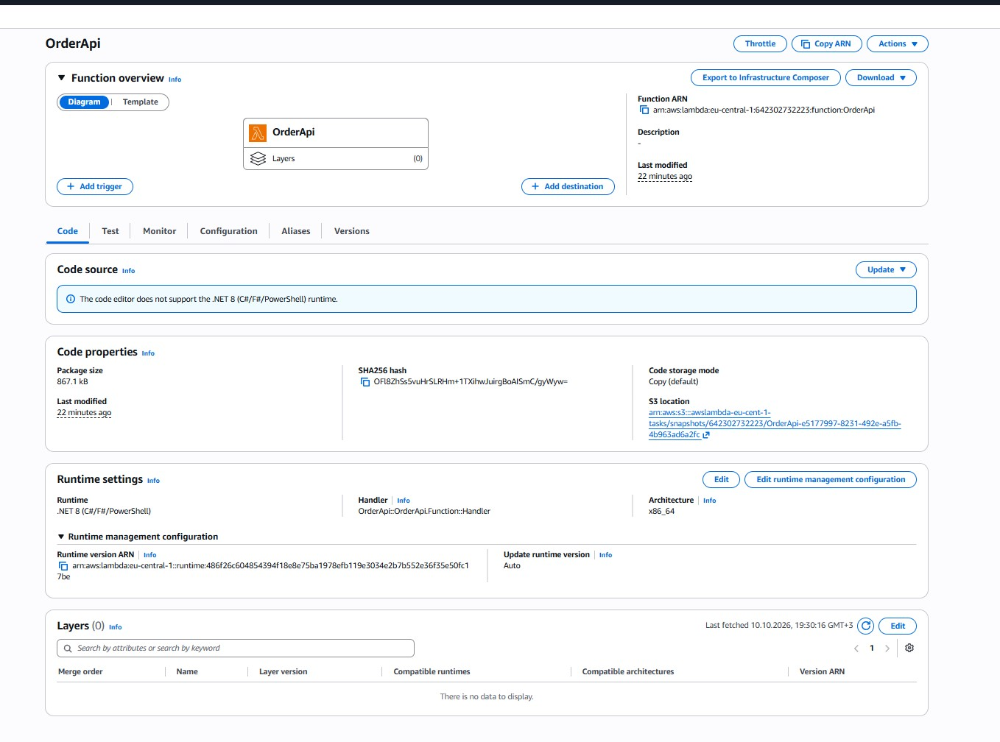
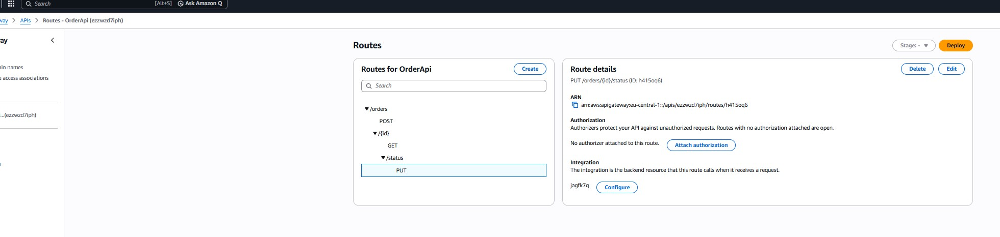
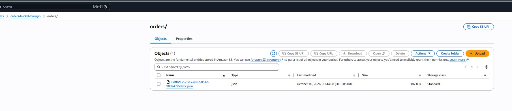
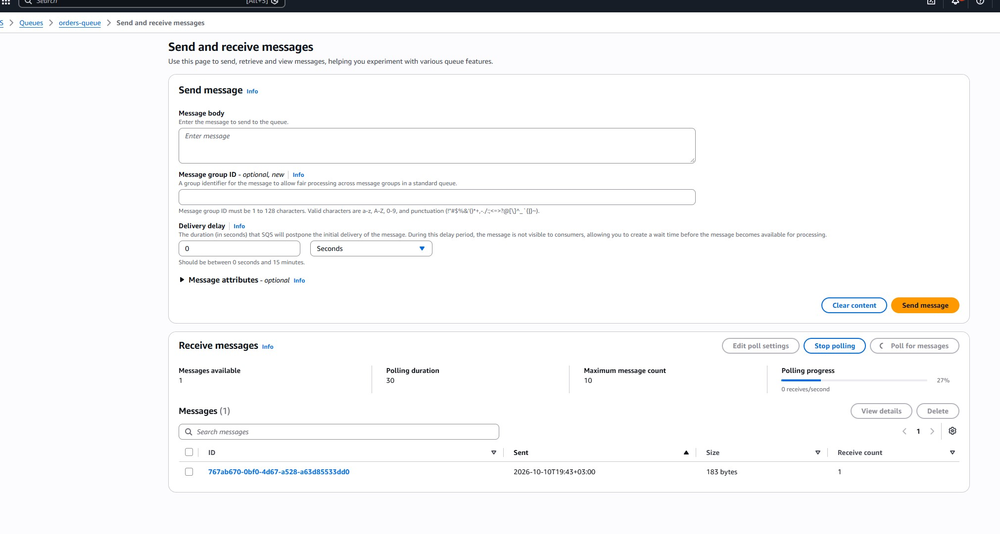
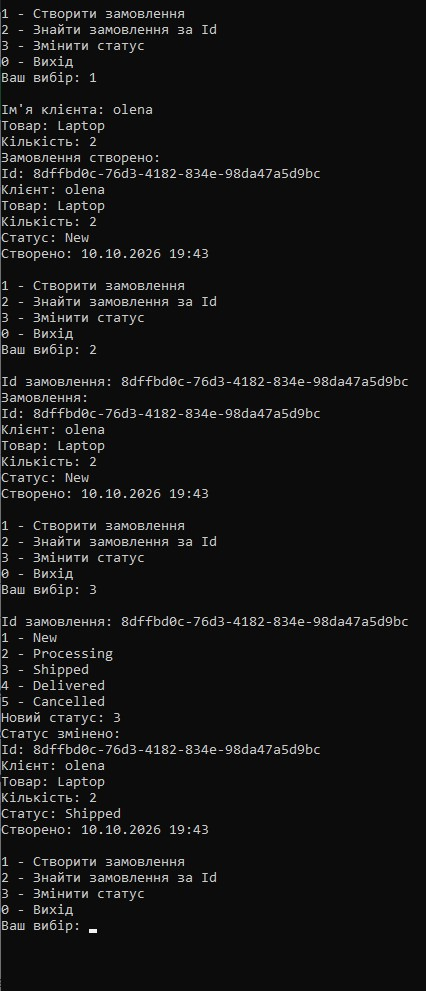
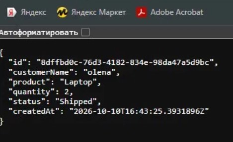

# Serverless Order API

Екзаменаційна робота з дисципліни «Створення хмарних рішень з використанням AWS», варіант 4.

Виконав: Брузгін Олександр, група П42
Викладач: Сиворка В. А.

## Що зроблено

Система для замовлень без свого сервера. Запити приймає API Gateway і передає їх у Lambda. Lambda зберігає замовлення в S3 у вигляді json-файлу, а коли створюється нове замовлення, відправляє повідомлення в чергу SQS.

Для роботи з API зробив консольний клієнт на C#. Можна створити замовлення, знайти його по Id і змінити статус.

У замовленні є: Id, ім'я клієнта, товар, кількість, статус і дата створення.

## Які сервіси AWS використав

- AWS Lambda — функція OrderApi на .NET 8, в ній вся логіка
- API Gateway (HTTP API) — три маршрути, які ведуть на Lambda
- Amazon S3 — бакет orders-bucket-bruzgin, замовлення лежать у папці orders/
- Amazon SQS — черга orders-queue, туди приходять нові замовлення
- IAM — роль для Lambda, щоб вона мала доступ до S3 і SQS
- CloudWatch — логи Lambda

Як це працює:

```
Консольний клієнт -> API Gateway -> Lambda -> S3
                                          -> SQS
```

У клієнті немає ключів AWS, він знає тільки адресу API. Lambda отримує доступ до S3 і SQS через IAM-роль, а назва бакета і адреса черги задані в змінних оточення Lambda (BUCKET_NAME і QUEUE_URL).

## URL API

https://ezzwzd7iph.execute-api.eu-central-1.amazonaws.com

## Маршрути

- `POST /orders` — створити замовлення
- `GET /orders/{id}` — отримати замовлення по Id
- `PUT /orders/{id}/status` — змінити статус

Статуси: New, Processing, Shipped, Delivered, Cancelled. Нове замовлення завжди має статус New.

Якщо дані неправильні, API повертає 400, якщо замовлення не знайдено — 404.

## Приклади запитів

Створити замовлення:

```
curl -X POST https://ezzwzd7iph.execute-api.eu-central-1.amazonaws.com/orders -H "Content-Type: application/json" -d "{\"customerName\":\"sanya\",\"product\":\"Laptop\",\"quantity\":2}"
```

Що повертає:

```json
{
  "id": "8dffbd0c-76d3-4182-834e-98da47a5d9bc",
  "customerName": "sanya",
  "product": "Laptop",
  "quantity": 2,
  "status": "New",
  "createdAt": "2026-10-10T16:43:25.3931896Z"
}
```

Отримати замовлення (можна просто відкрити в браузері):

```
curl https://ezzwzd7iph.execute-api.eu-central-1.amazonaws.com/orders/8dffbd0c-76d3-4182-834e-98da47a5d9bc
```

Змінити статус:

```
curl -X PUT https://ezzwzd7iph.execute-api.eu-central-1.amazonaws.com/orders/8dffbd0c-76d3-4182-834e-98da47a5d9bc/status -H "Content-Type: application/json" -d "{\"status\":\"Shipped\"}"
```

## Структура проєкту

- `OrderApi` — проєкт Lambda. Handler: `OrderApi::OrderApi.Function::Handler`
- `OrderClient` — консольний клієнт, адреса API вказана в `config.json`

## Як запустити

Lambda:
1. `dotnet publish -c Release -o publish` у папці OrderApi
2. запакувати вміст папки publish у zip і завантажити в Lambda
3. вказати Handler і змінні оточення BUCKET_NAME, QUEUE_URL
4. дати ролі Lambda доступ до S3 і SQS
5. в API Gateway створити HTTP API з трьома маршрутами на цю Lambda

Клієнт: відкрити рішення у Visual Studio, зробити OrderClient стартовим проєктом і запустити.

```
1 - Створити замовлення
2 - Знайти замовлення за Id
3 - Змінити статус
0 - Вихід
```

## Скріншоти

Lambda



Маршрути в API Gateway



Замовлення в S3



Повідомлення в SQS



Робота консольного клієнта



Запит GET у браузері


